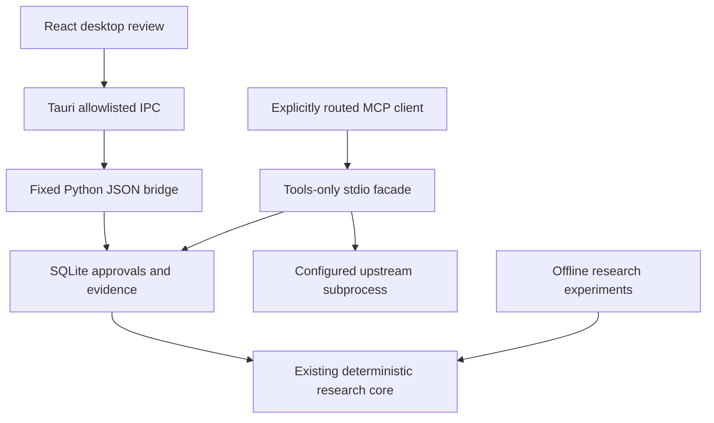

# Architecture — unreleased research and desktop prototype

The Python research engine is retained. Security authority does not depend on an
ML model, a cloud service or the renderer. The baseline source inventory is in
[audit/SOURCE_MAP.md](audit/SOURCE_MAP.md); changes and limits are tracked in
[IMPLEMENTATION_PROGRESS.md](IMPLEMENTATION_PROGRESS.md).

| Component | Responsibility | Trust and current scope |
|---|---|---|
| `canonicalize.py`, `diff.py`, `models.py` | Context-aware canonicalization, separate exact hashes, typed changes, integrity verification | Descriptors are untrusted data; normalized hashes never grant consent |
| `features.py`, `capabilities.py`, `temporal.py` | Interpretable inferred capabilities and approved/adjacent temporal evidence | Heuristic evidence; no runtime capability verification |
| `gateway.py` | Persistent identities, catalogs, approvals, quarantine latches, revisions, audit and protected dispatch | Trusted local SQLite store; bounded comparison with manual fallback |
| `gateway_transport.py` / `gateway_http.py` | Fixed-argv stdio or configured HTTPS upstream; identity binding, JSON/SSE, routing headers, complete relisting and independent text egress checks | Explicit legacy/modern tools subset; no OAuth, sandbox, general server callbacks or complete output protection |
| `gateway_cli.py` | Opt-in client-facing stdio facade and safe identity diagnostic | Stdout is protocol only; no approval method is exposed through MCP |
| `desktop_bridge.py` | One JSON request per process; fixed review action allowlist | Native host selects DB; imported sources use a namespace distinct from live gateway identities |
| `desktop/src-tauri` | Native shell, capability/CSP, fixed packaged engine or debug-only isolated Python and bounded response | No shell/filesystem/network plugins, renderer path/executable override or HTTP listener |
| `desktop/src` | Overview, imported/observed sources, review, history, activity, annotation, appearance | Browser fixture mode is isolated and explicit; UI does not establish live gateway health |
| `sequential_experiments.py` | Isolated EWMA and standardized multivariate CUSUM | Experimental; not plugged into authorization |
| `capability_graph.py` | Typed evidence-bearing reachability witnesses and graph updates | Explicit graph inputs; not inferred runtime authority, not deployed enforcement |
| `annotation_workflow.py`, `statistics.py`, `splits.py` | Independent annotation checks, whole-repository resampling, temporal split validation | IDs cannot certify human identity; frozen independent evidence is still needed |

## Data and control separation

An observed definition is stored separately from its consent record. Consent binds
exact JSON, configured identity, live session/principal, protocol, policy and tool
revision. Review reads return detached values. A changed definition requires a new
decision even when the heuristic classifier calls it benign. Quarantine is latched
per exact definition. Revocation removes authority without deleting evidence.

Calls relist and recheck before forwarding under a local transaction. Unsupported
methods/contracts fail closed. A stale or disconnected process cannot replace a
new session's binding. Remote handler changes that retain the same descriptor are
not proven safe: see [SECURITY_MODEL.md](SECURITY_MODEL.md).

Manual imports are an inspection feature. Their `import:` identities and
`manual-import` principal cannot grant approval to a live stdio connection.
The desktop reads a shared state file; it does not launch a server simply because
the user imported a definition. Credentials are not managed by this prototype.

## Research versus product

Optional embeddings, learned baselines and publication experiments remain in Python
and load only when explicitly requested. The default app does not download model
weights. Cloud analysis and telemetry have no configured implementation.
Experimental models cannot weaken exact consent enforcement.

The isolated guided scenario is generated by
`python desktop/scripts/generate-demo.py` using the actual deterministic engine.
It has no network connection and makes no accuracy claim. Research annotations are
blinded, explicit and exportable; navigating between pages retains the in-memory
session. Export before closing. Human independence remains a procedural requirement.

## Resource and distribution decisions

Default runtime dependencies are Pydantic and JSON Schema validation; React and the
OS WebView render the desktop interface. Dependency constraints, npm integrity lock
and Cargo lock are committed. Models and experiment data are not installer assets.
Profile measurements describe generated fixtures and Python allocations, not whole
app memory or production latency. See [audit/local-core-profile.json](audit/local-core-profile.json).

The native IPC path uses one deadline for queueing, input/output and exit, validates
response envelopes and emits explicit UTF-8 bytes across the Python boundary.
Timeouts require refresh because a review mutation may already have committed;
no automatic replay or descendant sandbox is claimed.

Source development may use a separately installed Python virtual environment.
Packaged builds include the fixed Python engine and reject environment executable overrides.
Bundled engines, endpoint-bound OS credentials and automated native startup checks
are implemented. Signed production installation, secure update trust and manual
native interaction/accessibility verification remain release work. The architecture
decision is [adr/desktop.md](adr/desktop.md).

## Native completion followup

The setup screen generates explicit stdio/HTTPS profiles and the chosen client's
gateway configuration. HTTP credentials are endpoint-bound OS-store entries or
named environment references; only store/remove metadata returns to the renderer.
Local heartbeat rows describe gateway process activity, independently of approval.

Packaged verification executes the frozen engine, checks the installed/bundled
resource and launches the real WebView. Renderer-triggered SQLite initialization
provides end-to-end startup evidence. Linux's headless runner uses software
compositing under Xvfb; that is a test-environment setting, not a product default.
See the current platform matrix for executed results rather than treating the
existence of a test script as proof of a pass.
