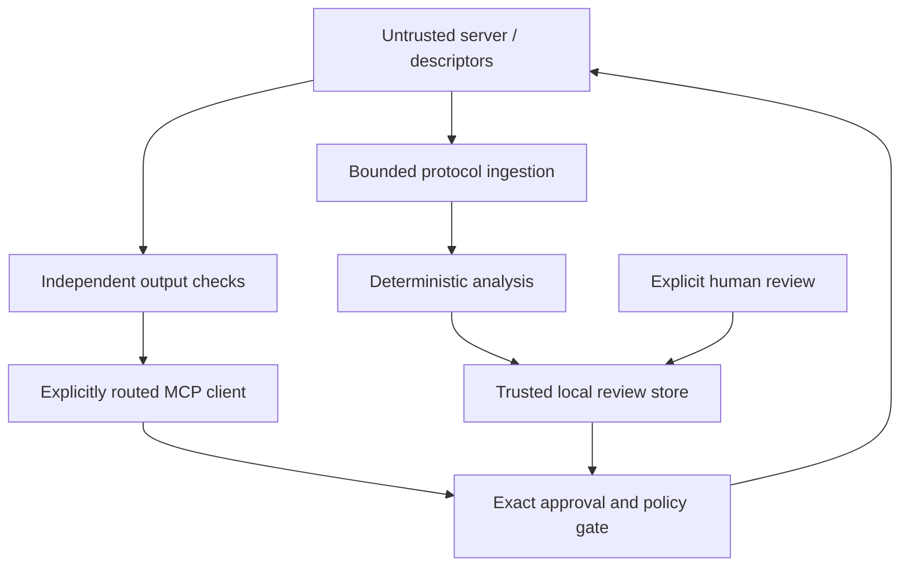

# Baseline audit — 15 October 2026

Authoritative source: `https://github.com/parthdongre/mcp-driftguard`, branch `main`,
HEAD `9fcab36176279d77c4dd7f1950d47e4991697cf7`, package v0.4.0.
The checkout was clean. No `AGENTS.md` was present. The proprietary license,
Parth Dongre attribution, prior commits, data manifests and research protocols are retained.
All development takes place on `dev/research-gateway-desktop`; no merge or public release is authorized.

## Reproduced baseline

Linux x86-64, Python 3.12.14; Pydantic 2.13.5, NumPy 2.3.5,
scikit-learn 1.8.0, pytest 9.1.1, Ruff 0.17.1. Full environment:
`baseline-environment.json`.

```bash
python -m pip install -e '.[dev]' scikit-learn pytest-cov
python -m pytest -q --cov=driftguard --cov-report=json --junitxml=baseline-tests.xml
python -m ruff check src tests --output-format=concise
```

Result: **98 passed, 1 skipped, 25.97 s**, lint passed. Optional XGBoost was absent.
Statement coverage: **3134/3682 = 85.12%**. No native/platform, live MCP, or
publication-grade evaluation was established by this run. Coverage measures
executed lines; it does not establish algorithmic correctness or adversarial safety.
Machine-readable evidence is retained alongside this report.

## Architecture mapping

[`SOURCE_MAP.md`](SOURCE_MAP.md) maps every baseline Python module, experiment and
test to public definitions, internal imports and measured statement coverage.
The existing Python package has distinct snapshot/diff, feature, optional ML,
sequence/policy, static ingestion, annotation and evaluation layers.

| Surface | Confirmed baseline implementation | Missing or limited at baseline |
|---|---|---|
| Canonical snapshots | Stable key ordering, human-text normalization, schema hashes | Context-insensitive literal normalization; mutable nested data |
| Structural comparison | Parameters/defaults/required/URL/annotation signals | Union-type crash; missing/null and bool/number confusion; shallow typed deltas |
| Capabilities | Interpretable descriptor-derived profiles | Not evidence of runtime permissions/behavior |
| ML | Lazy embeddings, logistic/XGBoost models and ablations | No frozen independent test corpus; hard rule scores are not calibrated probabilities |
| Temporal | Approved and adjacent comparisons, CUSUM-style accumulation | One evaluator ignores approved version; onset metric credits early blocks |
| Data ingestion | Static AST/JSON plus Git history, rename-aware lineage | Only source manifests in checkout; incomplete extractor coverage; symlink traversal |
| Annotation | Typed annotation/adjudication and agreement helpers | Duplicate/self identifiers accepted; no interactive annotation workspace |
| Statistics | Scalar bootstrap and paired differences, Brier/ECE helpers | No explicit whole-repository resampling for nonlinear metrics |
| Protocol enforcement | Research policy simulation and CLI demonstration | No real transport, trust store or forwarding boundary |
| Desktop | None | Native shell, review flow, accessibility, packaging and platform tests |
| Reproducibility | Experiment manifests, split validation, readiness declarations | Readiness booleans do not independently authenticate evidence |

## Confirmed defects and priority

| ID | Priority | Reproduction / consequence | Planned repair |
|---|---|---|---|
| A01 | P0 | Literal `default.description` whitespace and literal `enum` arrays can hash identically despite different values | Schema-context traversal; separate exact JSON digest for consent |
| A02 | P0 | Schema type `string` → `[string,null]` raises Pydantic validation error | Accept legal type unions; reject malformed ingress |
| A03 | P0 | `default: true` → `default: 1`, or missing → null, can disappear from typed diff | JSON-aware equality and presence checks |
| A04 | P0 | Nested snapshot mutation leaves stale `sha256` | Reconstruct/deep-copy at trust boundary; integrity-check persisted data |
| A05 | P1 | Block at step0 with attack onset2 earns detection=1 and delay=0 | Separate pre-onset intervention from post-onset detection |
| A06 | P1 | `evaluate_trajectory` starts at step0 regardless of approved version | Validate and honor unique approved version |
| A07 | P1 | Self-agreement / duplicate annotator references accepted | Distinct identifiers and optional source-reference verification |
| A08 | P1 | Naive vs aware timestamp comparison raises uncaught TypeError | Require explicit time zones; normalize UTC |
| A09 | P1 | Discovery can follow source-file symlinks outside checkout | Skip symlinks and prune ignored trees before traversal |
| A10 | P2 | Record-level bootstrap API cannot express clustered nonlinear metrics | Resample complete repository blocks and recompute metric |

P0 means implement before connecting an untrusted transport. These are local
reproductions, not reports of deployed exploitation. Research/annotation fixes
receive regression tests independently of security-gateway implementation.

## Security boundary



At baseline this boundary was a proposed placement, not a running gateway.
The implementation must preserve the distinction between descriptor claims,
local approval, observed transport identity and actual server behavior. Neither
relisting nor a hash prevents a malicious server from changing its handler while
returning the same definition. A launched stdio server has user-level privileges.

## Research and dataset readiness

Only `public_corpus_sources.json` (12 candidates) and expansion manifest (18
candidates) were checked in. The pool of 30 includes SDK/reference repositories,
unsupported languages and wrappers; it cannot be counted as 30 independently
mined production histories. No human-label or final-test evidence was present.
Existing controlled benchmarks remain development-only, even when a score exceeds95%.

The research review must include Interlock and September2026 formation-consistent
dispatch work before making a novelty statement. Targets in PAPER_PROTOCOL.md are
success criteria, not observed results. Human independence cannot be certified
from identifier strings alone.

## Dependencies, performance and desktop feasibility

Baseline runtime has one direct dependency (`pydantic`), broad version ranges,
optional ML/API extras, no lockfile. The five installed Pydantic runtime packages
were checked with pip-audit: no known advisories returned for those exact versions.
This is a dated advisory lookup, not proof of supply-chain security. The new
schema-validation dependency requires its own audit and reproducible constraints.
CI uses version tags for actions; release hardening should pin reviewed action SHAs.

Confirmed performance hazards: source traversal visited ignored directory trees,
and pairwise `SequenceMatcher` can be expensive on large adversarial definitions.
Hypotheses needing measurement: repeated feature extraction, SQLite history growth,
embedding cold starts and repeated executable hashing. Bounded exact-change/manual
review should precede expensive comparison for large definitions. No model should
download on a normal desktop launch.

Tauri2 with a thin React interface is feasible while preserving Python research
code. The first deliverable should use a fixed native-to-Python JSON command,
no renderer-supplied executable/path, local app-data state and no HTTP listener.
Development Python integration is distinct from a bundled signed release.
Native macOS/Windows installers, signing/notarization, OS credential vaults and
updater distribution require separate validation. Linux browser tests cannot
establish native cross-platform behavior.

## Next acceptance gates

1. Correctness regressions pass and baseline CLI remains runnable.
2. Exact, identity/policy/revision-bound persistent approval works before dispatch.
3. Authored subprocess tests demonstrate discover → review → call → changed definition → block.
4. Desktop renders real review evidence; fixture mode is explicit and isolated.
5. Whole-repository uncertainty, independent annotation workflow and reproducible experimental methods exist.
6. Publication and native-release readiness remain false until their missing evidence exists.
